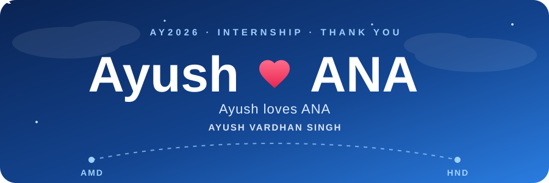
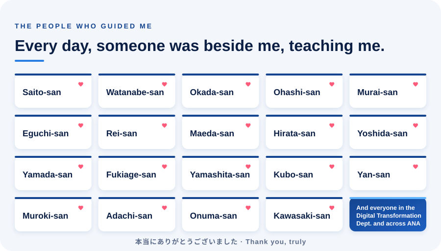
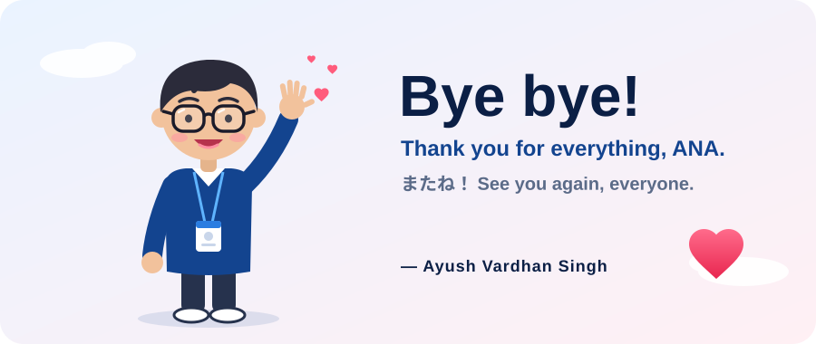

  

<h3 align="center">Hi, I'm Ayush Vardhan Singh 👋</h3>

  AY2026 intern at ANA · Digital Transformation Dept. 
  From Ahmedabad (AMD) to Haneda (HND), and the best few months of learning I could ask for. ✈️💙

 

  

 

  

  Made with ❤️ in Tokyo · 2026

